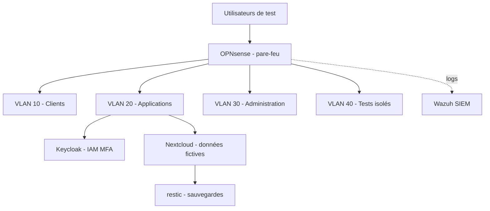

# Architecture — OsySpark Secure Cloud

## Portée
Startup fictive : 8 utilisateurs aujourd'hui, jusqu'à 20 à 12 mois. Le laboratoire est un projet académique, non une infrastructure de production.

## Architecture logique

## Plan d'adressage proposé
| Zone | VLAN | Réseau de laboratoire |
|---|---:|---|
| Clients | 10 | `10.60.10.0/24` |
| Applications | 20 | `10.60.20.0/24` |
| Administration | 30 | `10.60.30.0/24` |
| Tests isolés | 40 | `10.60.40.0/24` |

**Politique :** refus inter-VLAN par défaut, puis exceptions métier strictement nécessaires. Garder les essais isolés de tout réseau tiers.

## Ressources et limites
- Proxmox VE sur ordinateur existant, si compatible.
- OPNsense pour le filtrage et la segmentation.
- Keycloak pour les démonstrations SSO, MFA et RBAC.
- Wazuh pour les journaux et alertes, si le matériel le permet.
- Nextcloud et restic pour les données de test et la restauration.
- Exécuter certains services à tour de rôle sur une machine limitée en RAM.
- Aucune interface d'administration directement exposée sur Internet.
- Pas de données réelles, aucun mot de passe ni secret publié.
- Une VM de laboratoire ne démontre pas une haute disponibilité de production.
